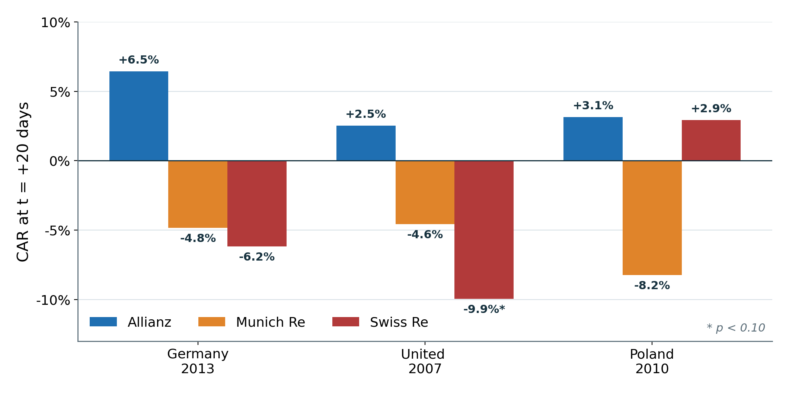
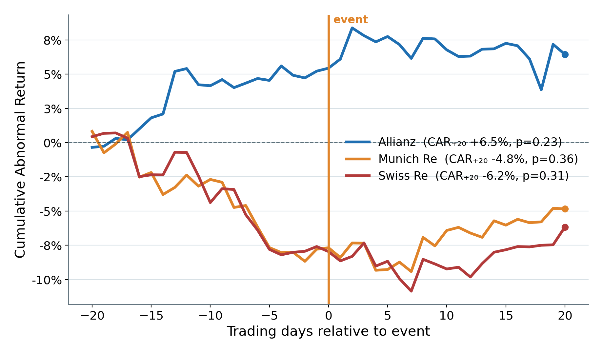

# Do Europe's Largest Floods Move Insurer Stock Prices?

**An event study of Allianz, Munich Re and Swiss Re around the three costliest European floods of 2000–2020**



## Research question

Floods are among the largest catastrophe losses for European primary insurers and reinsurers. If equity markets price catastrophe exposure efficiently, the largest flood events should show up as **abnormal returns** in insurer share prices. This project tests that with a standard market-model event study.

## Data

| Source | Use |
|---|---|
| HANZE (Historical Analysis of Natural Hazards in Europe) flood database (`HANZE_events.csv`) | 2,521 historical European flood events; filtered to 2000–2020 (861 events) and ranked by losses in 2020 euros |
| Yahoo Finance via `yfinance` | Daily adjusted prices for **ALV.DE** (Allianz), **MUV2.DE** (Munich Re), **SREN.SW** (Swiss Re) and the **STOXX Europe 600** benchmark |

The three costliest floods in the sample were Central Europe / Germany (May 2013, €9.2bn), the United Kingdom (June 2007, €4.7bn) and Poland (May 2010, €3.4bn).

## Methodology

1. **Returns:** daily log returns, aligned across stocks and benchmark.
2. **Expected returns:** CAPM market model, *R<sub>i,t</sub> = α<sub>i</sub> + β<sub>i</sub> R<sub>m,t</sub> + ε<sub>i,t</sub>*, estimated by OLS over the window **[−250, −20]** trading days before the event.
3. **Abnormal returns:** *AR<sub>t</sub> = R<sub>i,t</sub> − (α̂ + β̂ R<sub>m,t</sub>)* over the event window **[−20, +20]**.
4. **Cumulative abnormal returns (CAR):** the running sum of AR across the window.
5. **Inference:** *SE(CAR<sub>L</sub>) = σ̂<sub>ε</sub> √L*, with σ̂<sub>ε</sub> taken from the estimation-window residuals; two-tailed test of CAR(+20) = 0 with 95% confidence bands.



## Results: CAR at t = +20

| Event | Allianz | Munich Re | Swiss Re |
|---|---|---|---|
| Germany 2013 | +6.5% (p = 0.23) | −4.8% (p = 0.36) | −6.2% (p = 0.31) |
| United Kingdom 2007 | +2.5% (p = 0.62) | −4.6% (p = 0.36) | **−9.9% (p = 0.06)** |
| Poland 2010 | +3.1% (p = 0.64) | −8.2% (p = 0.19) | +2.9% (p = 0.78) |

Estimated betas range from 0.62 to 1.47.

## Interpretation

- **None of the nine CARs is significant at the 5% level.** The only result close to significance is Swiss Re after the 2007 UK floods, at the 10% level.
- **A consistent pattern in sign:** the **reinsurers** (Munich Re, Swiss Re) show negative CARs in five of six cases, while the **primary insurer** Allianz is positive in all three. This fits the idea that reinsurers carry the peak catastrophe risk, and that primary insurers can recover losses through reinsurance and later premium increases.
- **The practical takeaway:** even the largest European floods appear to be largely **diversifiable** for globally diversified (re)insurers, or already priced in through catastrophe models and reinsurance structures.

## Limitations

- **Small sample:** three events, so statistical power is low.
- **Confounding events:** the 2007 window overlaps the start of the subprime crisis, and the reinsurers' CARs drift down *before* t = 0 in 2013. Neither move can be attributed to the flood alone.
- **Event dating:** HANZE records the flood's start date, while losses become clear gradually over days or weeks.
- **Standard errors:** the CAR test assumes independent, identically distributed residuals and ignores estimation error in α and β (Patell- or BMP-type tests would be more robust).

## Repository

| File | Contents |
|---|---|
| `event_study.ipynb` | Full pipeline: data filtering, CAPM estimation, AR/CAR, significance tests, 3×3 CAR grid |
| `presentation_charts.ipynb` | Regenerates results and the presentation-styled charts in `assets/`, and writes `results.json` |
| `results.json` | Betas, alphas, CAR paths and standard errors per event and stock |
| `HANZE_events.csv` | Flood event data |

## Run it

```bash
pip install -r requirements.txt
jupyter notebook event_study.ipynb
```

---
*Part of my MSc International Finance project work (HWR Berlin). Methods: event studies, CAPM, OLS, hypothesis testing.*
